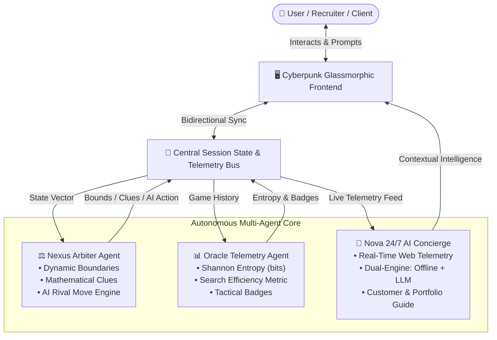
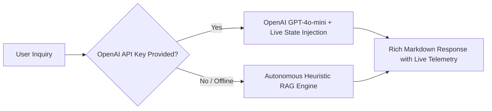

<div align="center">

# 🧠 NEXUS MIND // Autonomous Multi-Agent Gaming & Intelligence Platform

### *A High-Performance Showcase Engineered by an Agentic AI Developer*

[](https://www.python.org/)
[](https://streamlit.io/)
[](#multi-agent-system-architecture)
[](#nova-247-live-ai-concierge)
[](LICENSE)

<br/>

**[🎮 Live Demo](#quick-start-in-60-seconds)** • **[📋 System Specifications](SPECS.md)** • **[🤖 Agent Ecosystem](#multi-agent-system-architecture)** • **[💼 Portfolio Contact](#architect--developer-portfolio)**

---

</div>

## 🌟 Overview

**Nexus Mind** transforms the classic number guessing problem into a **production-grade Agentic AI demonstration**. 

Rather than a simple procedural script, the platform is architected as an **Autonomous Multi-Agent System (MAS)** where distinct specialized agents coordinate in real time:
- **⚖️ Nexus Arbiter Agent:** Orchestrates dynamic search space contraction, generates progressive mathematical clues (parity, prime sieve, divisor relations), and commands an autonomous AI rival.
- **📊 Oracle Telemetry Agent:** Calculates real-time **Shannon Information Entropy ($H = \log_2 N$)**, evaluates logarithmic search efficiency ($O(\log N)$ optimality), and awards tactical performance badges.
- **🤖 Nova 24/7 Live AI Concierge:** A live conversational support and coaching agent that continuously monitors live web state, handles player inquiries, delivers strategic hints, and provides portfolio information with a **zero-downtime dual-engine architecture** (Autonomous Offline Heuristic Engine + optional OpenAI GPT-4o integration).

---

## ⚡ Key Highlights & Why It Belongs on a Portfolio

- 🧩 **Agentic System Architecture:** Separation of concerns across independent agents with synchronized session telemetry.
- 💬 **24/7 Live AI Concierge (Nova):** Knows the *exact* current game mode, target boundary, attempt history, and win streaks. Fully bilingual (English & Roman Urdu) with offline resilience!
- 📡 **Shannon Entropy & Decision Telemetry:** Real-time information theory calculations proving mathematical depth.
- 🤖 **Human vs Autonomous AI Duel Mode:** Play against an autonomous AI agent in a turn-based race to deduce the secret number.
- 🎨 **Modern Cyberpunk Glassmorphism:** Sleek dark-mode interface with backdrop blurs, luminous status indicators, and dynamic feedback radars.
- 🔍 **Real-Time Agent Reasoning Logs:** Live event stream tab where recruiters and visitors can inspect the actual communication traces between agents.

---

## 🏗️ Multi-Agent System Architecture



---

## 🎮 Game Operation Modes

### 1. 🎯 Adaptive Arena (Single Player with AI Co-Pilot)
- Choose from **Casual (1-20)**, **Standard (1-100)**, **Master (1-500)**, or **Custom Search Ranges**.
- Real-time **Thermal Proximity Radar**: `🔥 BOILING HOT`, `🌡️ WARM`, `🌤️ LUKEWARM`, `❄️ SUB-ZERO COLD`.
- Real-time boundary contraction progress bar.
- On-demand mathematical deductions from the Arbiter Agent.

### 2. 🤖 Human vs Autonomous AI Agent Duel
- Turn-based battle between you and an Autonomous AI Rival.
- Watch the AI agent calculate binary search midpoints and narrow the boundary live on screen!
- First entity to identify the target wins the round.

### 3. ⚡ Quantum Countdown (Limited Moves)
- Moves strictly bounded by theoretical binary search limits:
  $$\text{Allowed Moves} = \lceil\log_2 N\rceil + 2$$
- Test your logarithmic convergence under high stakes.

---

## 🤖 Nova: 24/7 Live AI Concierge & Support Agent

Nova is engineered for **unconditional 24/7 availability**:



- **Live Context Ingestion:** Nova dynamically inspects:
  - Active game mode and current target boundary `[low .. high]`
  - Number of deduction attempts taken
  - Full guess history and feedback results
  - Lifetime win/loss ratio and current win streaks
- **Recruiter & Customer Ready:** Visitors can click quick-action buttons to ask:
  - *"Tell me about the developer who built this project."*
  - *"How does the multi-agent system work?"*
  - *"Give me a mathematical clue for the active range."*
  - *"Analyze my gameplay efficiency."*

---

## 📊 Mathematical Foundations

### 1. Algorithmic Search Efficiency ($E$)
$$\text{Optimal Steps} = \lceil\log_2(N)\rceil$$
$$E = \min\left(120\%, \max\left(10\%, \frac{\text{Optimal Steps}}{\text{Actual Steps}} \times 100\%\right)\right)$$

### 2. Shannon Information Entropy ($H$)
$$H(S) = \log_2(|S|) \quad \text{bits}$$
As each guess bisects or contracts the search interval, the remaining uncertainty is dynamically plotted in bits.

---

## 🚀 Quick Start in 60 Seconds

### Prerequisites
- Python 3.10, 3.11, or 3.12 installed.

### 1. Clone or Open the Repository
```bash
git clone https://github.com/SainBux-HadiSeelro/nexus-mind-agentic-platform.git
cd nexus-mind-agentic-platform
```

### 2. Install Dependencies
```bash
pip install -r requirements.txt
```
*(Or simply run `pip install streamlit openai python-dotenv`)*

### 3. Launch the Platform
```bash
streamlit run app.py
```
Open [http://localhost:8501](http://localhost:8501) in your browser!

---

## 📁 Repository Structure

```
nexus-mind-agentic-platform/
├── app.py                 # Core Streamlit Web Application & Cyberpunk UI
├── SPECS.md               # Complete System Specifications & Architecture Docs
├── README.md              # Showcase Portfolio Documentation
├── requirements.txt       # Streamlit Cloud pip dependencies
└── agents/
    ├── __init__.py        # Agent module exports
    ├── arbiter_agent.py   # Nexus Arbiter & Dynamic Difficulty Agent
    ├── analytics_agent.py # Oracle Telemetry & Shannon Entropy Agent
    └── support_agent.py   # Nova 24/7 Live Concierge & Customer Agent
```

---

## 👨‍💻 Architect & Developer Portfolio

This project was built to demonstrate **high-standard Agentic AI Engineering**, showing how autonomous agents can transform simple utility code into rich, intelligent, resilient web systems.

- **Developer:** Sainbux (Hadi) Seelro | Agentic AI & Systems Engineer
- **Specialties:** Autonomous Multi-Agent Swarms, RAG Architectures, Telemetry & Intelligent Web Applications
- **GitHub:** [github.com/SainBux-HadiSeelro](https://github.com/SainBux-HadiSeelro)
- **Repository:** [nexus-mind-agentic-platform](https://github.com/SainBux-HadiSeelro/nexus-mind-agentic-platform)

---

<div align="center">
    <b>⭐ If you find this project impressive, don't forget to star the repository! ⭐</b>
</div>
