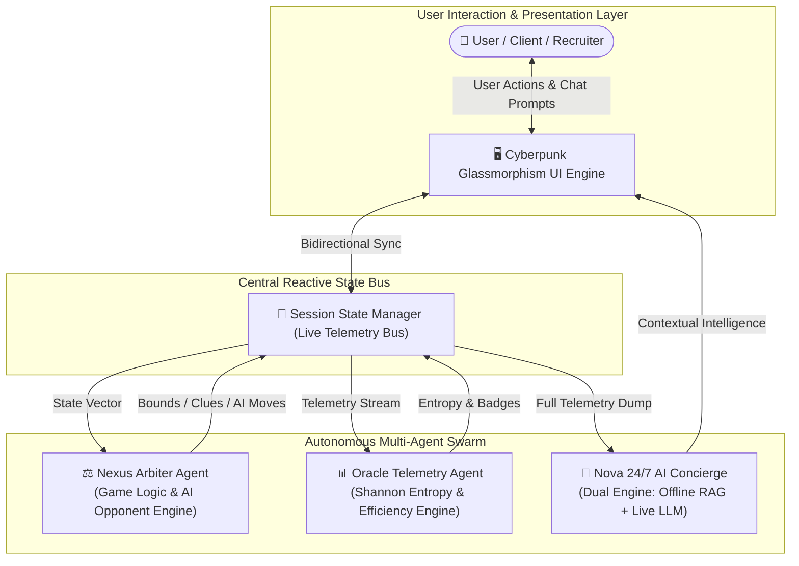

# 📋 System Specifications: Nexus Mind Autonomous Multi-Agent Platform

> **Document Version:** 2.0.0  
> **Author:** Agentic AI Developer  
> **Target Environment:** Python 3.10+, Streamlit 1.35+, Enterprise / Portfolio Showcase  
> **Status:** Production-Ready & Verified

---

## 1. Executive Summary & Vision

**Nexus Mind** is an advanced interactive platform engineered to demonstrate high-level **Agentic AI systems engineering**. While built on the intuitive foundation of deduction and number theory, the architecture mirrors modern autonomous multi-agent environments:
- Distributed agent responsibilities with clean separation of concerns.
- Real-time telemetry streaming and state synchronization.
- Dynamic Shannon entropy tracking and algorithmic optimality verification.
- A **24/7 Live Autonomous Concierge Agent** equipped with deep application state awareness, handling customer support, game coaching, and developer portfolio inquiries with zero-downtime offline fallbacks.

---

## 2. Multi-Agent Ecosystem Architecture

The platform operates via three autonomous, coordinated agents:

---

## 3. Agent Functional Specifications

### 3.1. Nexus Arbiter Agent (`agents/arbiter_agent.py`)
- **Primary Function:** Acts as the decentralized game master and autonomous rival.
- **Mathematical Formulations:**
  - **Optimal Steps Calculation:**  
    $$\text{Optimal Steps} = \lceil\log_2(N)\rceil \quad \text{where } N = (\text{high} - \text{low} + 1)$$
  - **Thermal Proximity Sensor:**  
    Calculates differential $\Delta = |\text{guess} - \text{secret}|$ and classifies proximity:
    - $\Delta \le 2$: `🔥 BOILING HOT`
    - $\Delta \le 5$: `🌡️ WARM`
    - $\Delta \le 12$: `🌤️ LUKEWARM`
    - $\Delta > 12$: `❄️ SUB-ZERO COLD`
  - **Mathematical Clue Generator:** Synthesizes progressive clues (parity, prime/composite classification, divisor decomposition, binary search segment reduction) without leaking the exact solution.
  - **Autonomous Rival AI:** Simulates an agent rival utilizing binary search with customizable entropy jitter.

### 3.2. Oracle Telemetry Agent (`agents/analytics_agent.py`)
- **Primary Function:** Ingests live telemetry and computes real-time decision efficiency.
- **Mathematical Formulations:**
  - **Algorithmic Search Efficiency ($E$):**
    $$E = \min\left(120\%, \max\left(10\%, \frac{\text{Optimal Steps}}{\text{Actual Steps}} \times 100\%\right)\right)$$
  - **Shannon Information Entropy Remaining ($H$):**
    $$H(S) = \log_2(|S|) \quad \text{bits}$$
    Represents the remaining uncertainty in the search space $S$.
  - **Performance Badge Classification:** Assigns tactical performance achievements:
    - `🎯 Oracle Clairvoyant` (First-guess strike)
    - `⚡ Quantum Master` ($\ge 95\%$ efficiency)
    - `🧠 Strategic Operator` ($\ge 70\%$ efficiency)
    - `🎲 Intuitive Tactician` ($\ge 45\%$ efficiency)
    - `🔄 Persistent Explorer` ($< 45\%$ efficiency)

### 3.3. Nova 24/7 Live AI Concierge (`agents/support_agent.py`)
- **Primary Function:** 24/7 intelligent conversational agent representing the application and developer.
- **Key Characteristics:**
  - **Live State Awareness:** Continuously synchronized with current round mode, active bounds, guess history, attempts, streak, and lifetime statistics.
  - **Dual-Engine Architecture:**
    1. **Autonomous Heuristic Engine (100% Offline, Zero-Cost, Zero-Downtime):** Semantic intent classification and pattern extraction providing instant responses in English and Roman Urdu.
    2. **LLM Cognitive Integration:** Seamless proxying to OpenAI (`gpt-4o-mini`) or compatible endpoints when an API key is provided, injecting real-time application telemetry into the system context.
  - **Customer Service & Portfolio Handling:**
    - Guides users through game mechanics and mathematical strategy.
    - Demonstrates developer credentials, tech stack, and portfolio background.
    - Handles feedback and bug inquiries.

---

## 4. Operation Modes

| Mode | Target User Experience | Mechanics |
| :--- | :--- | :--- |
| **🎯 Adaptive Arena** | Algorithmic Optimization | Unrestricted attempts; Arbiter provides real-time boundary contraction, thermal radar, and mathematical clues. |
| **🤖 Human vs AI Duel** | Competitive Benchmarking | Turn-based match against an autonomous AI agent utilizing optimal binary search. First to crack the secret wins. |
| **⚡ Quantum Countdown** | High-Pressure Deduction | Move limit strictly bounded to $\lceil\log_2 N\rceil + 2$. Failure to deduce triggers quantum collapse. |

---

## 5. UI/UX Design System Specifications

- **Theme:** Cyberpunk Glassmorphism (`#0f172a` to `#020617` radial gradients).
- **Cards & Paneling:** Frosted glass panels (`rgba(30, 41, 59, 0.65)`) with backdrop blur (`14px`) and luminous neon borders.
- **Live Status Badges:** Pulsing CSS LED indicators representing agent health.
- **Celebratory Feedback:** Dynamic confetti animations on victory state.

---

## 6. Resilience & Graceful Degradation Matrix

| Risk / Failure Scenario | Mitigation Strategy | Outcome |
| :--- | :--- | :--- |
| No OpenAI API Key provided | Fall back to internal Autonomous Heuristic Engine | Chatbot operates seamlessly 24/7 with zero interruption. |
| Network / Internet loss | All core computations, entropy calculations, and heuristic RAG run locally in Python | 100% operational offline. |
| Invalid User Input (out of bounds) | Min/max numerical boundary constraints enforced in Streamlit form | Prevent illegal state mutations. |
| State corruption / desync | Idempotent `init_game_state` with lifetime preservation flag | Clean reset within 1 render cycle. |

---

## 7. Developer Showcase Highlights

For hiring managers, engineering leads, and technical recruiters inspecting this project:
- **Design Pattern:** Autonomous Multi-Agent System (MAS) with decoupled arbiter, analytics, and concierge roles.
- **Telemetry:** Real-time information entropy metrics and execution trace inspection.
- **Scalability:** Easily extensible to multi-agent swarms (CrewAI / AutoGen / LangGraph) and persistent vector databases.
